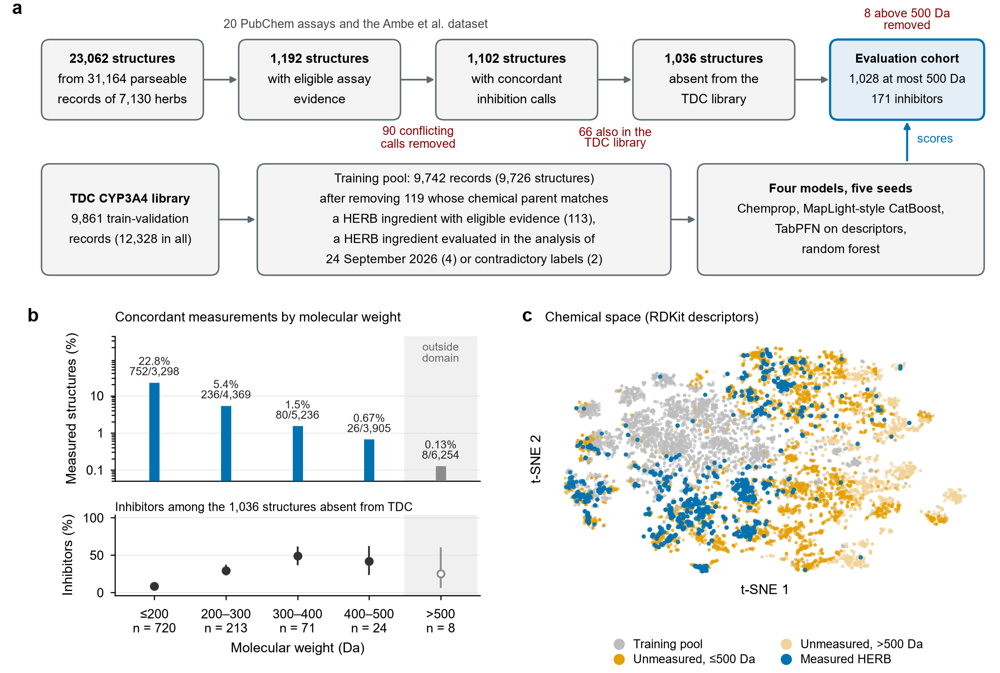
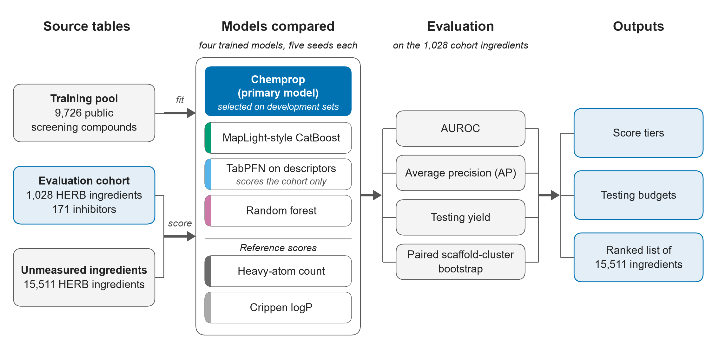
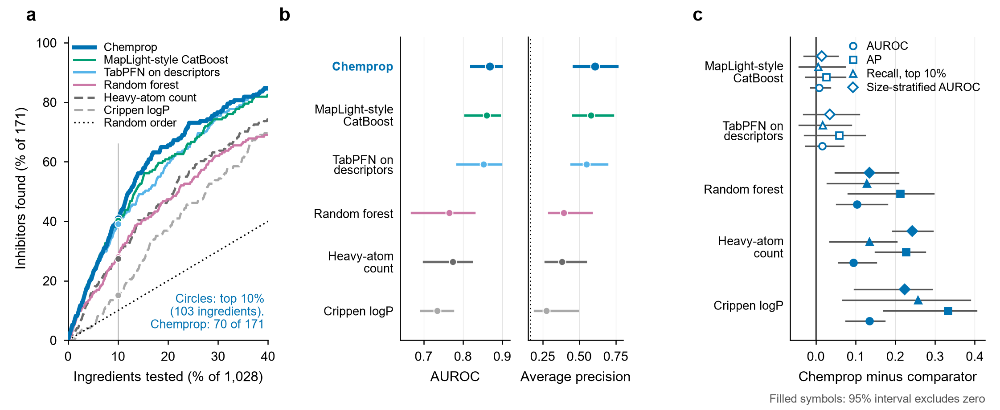
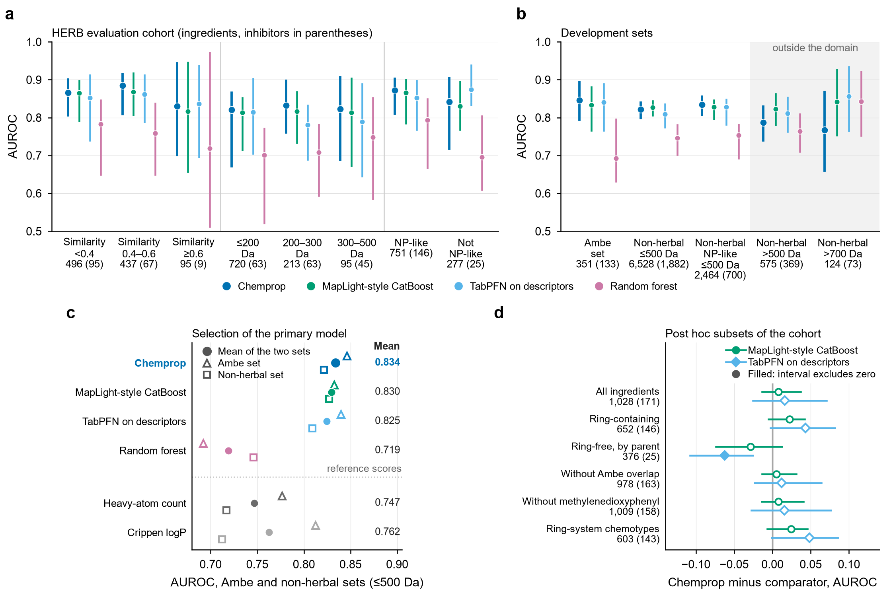
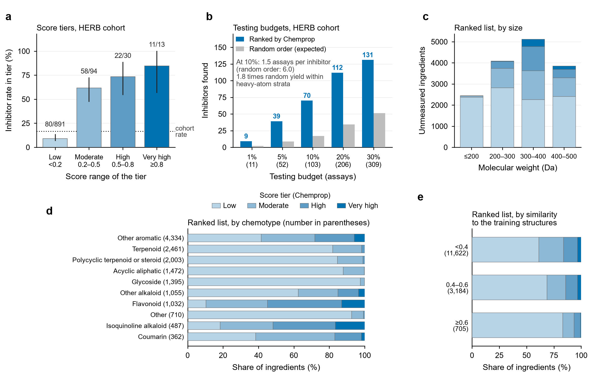
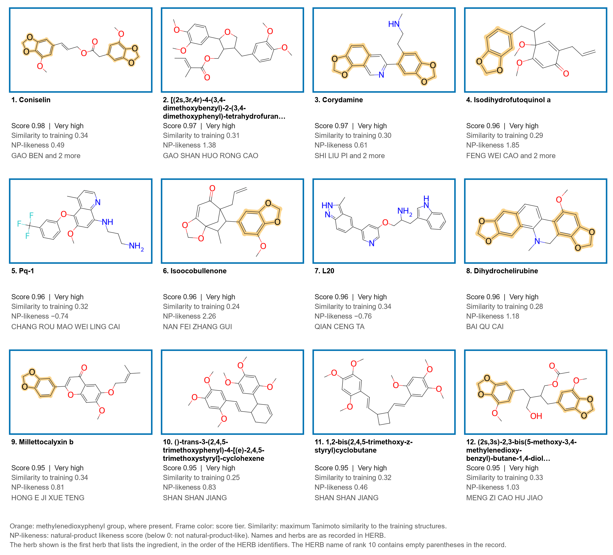
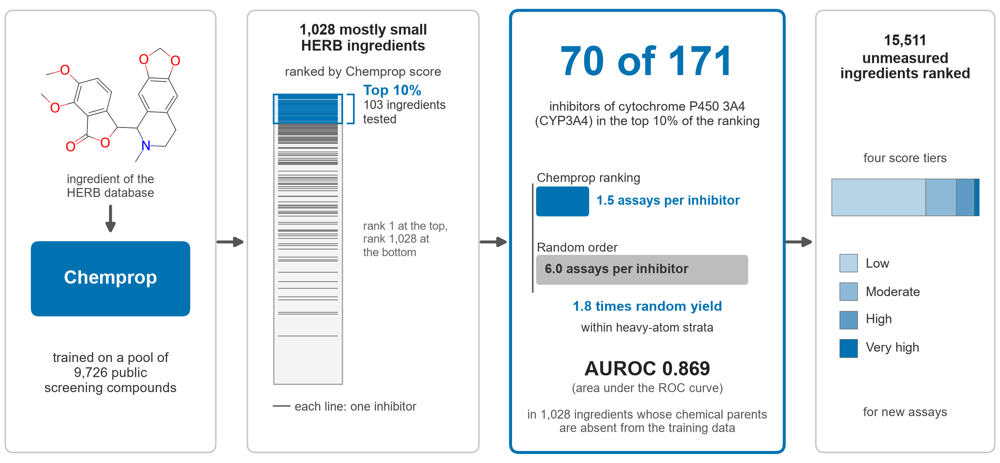

# HerbCYP

Code, input data, predictions and figures of the paper

> **Machine learning identifies CYP3A4-inhibiting herbal ingredients for herb–drug interaction screening**
> Hyunseung Kong, Seoul National University (manuscript in preparation)

Four models (Chemprop, a MapLight-style CatBoost, TabPFN on RDKit descriptors and a random forest) were trained on 9,726 public screening compounds (the CYP3A4 task of the Therapeutics Data Commons) and tested on 1,028 HERB ingredients of at most 500 Da with measured calls (171 inhibitors) whose chemical parents are absent from training. Chemprop is the primary model. Its scores give score tiers, testing budgets and a ranked list of 15,511 unmeasured HERB ingredients. The cohort was also scored in earlier analyses; Methods 2.2 and 2.4 of the paper give the study history.

## Main result (HERB cohort, 1,028 ingredients, 171 inhibitors)

| Score | AUROC (95% interval) | Average precision | Inhibitors in the top 10% (103 assays) |
| --- | --- | --- | --- |
| Chemprop (primary model) | 0.869 (0.822 to 0.897) | 0.608 | 70 of 171 |
| MapLight-style CatBoost | 0.861 (0.806 to 0.894) | 0.582 | 69 of 171 |
| TabPFN on descriptors | 0.853 (0.786 to 0.897) | 0.549 | 67 of 171 |
| Random forest | 0.765 (0.669 to 0.828) | 0.395 | 48 of 171 |
| Heavy-atom count | 0.775 (0.700 to 0.822) | 0.381 | 47 of 171 |
| Crippen logP | 0.734 (0.693 to 0.774) | 0.276 | 26 of 171 |

Intervals: paired scaffold-cluster bootstrap, 2,000 draws, seed 2026. The cohort is mostly small molecules (median 156 Da) and the ranked list mostly larger ones (median 320 Da); within weight classes the top 10% of the cohort holds 1.8 to 2.2 times the inhibitors of random testing (4.1 times overall; paper, Section 3.6). The ranked list of unmeasured ingredients is `analysis_single/results/final/app/unmeasured_ranked.csv.gz` (columns `rank`, `name`, `smiles`, `score`, `tier`, `herbs`, ...).

## Figures

**Fig1.** Study design and coverage of the evidence.



**Fig2.** Study flow chart.



**Fig3.** Ranking performance in the evaluation cohort.



**Fig4.** AUROC in strata of the cohort, in the development sets and in post hoc subsets.



**Fig5.** Score tiers, testing budgets and the ranked list of unmeasured ingredients.



**Fig6.** The twelve highest-ranked unmeasured ingredients.



**Graphical abstract.**



## Reproduce

The repository has the folder layout of the study; run the scripts from `analysis_single/code`. Python 3.11 with the packages of `requirements.txt` (RDKit is needed by `similarity.py` and by Fig. 6; the figures use the Arial font). The four models were trained on rented GPUs with torch 2.4.1 (CUDA 12.4), chemprop 2.3.1, catboost 1.2.10, tabpfn 2.0.9 and scikit-learn 1.6.1; retraining is not needed for the steps below.

```bash
pip install -r requirements.txt            # analysis and figures (CPU)
python verify/verify_headline.py           # recompute the headline numbers from the predictions and compare them with the tables (seconds)

cd analysis_single/code
python similarity.py                       # maximum Tanimoto similarity of every structure to the training sets
python select_primary.py                   # selection of the primary model on the two development sets
python run_all.py                          # AUROC, average precision, testing yield, paired scaffold-cluster bootstrap (estimates.csv, paired.csv)
python app_final.py                        # score tiers, testing budgets and the ranked list of unmeasured ingredients
python extra_herb.py                       # post hoc subsets of the cohort
cd ../fig && python run_figures.py         # Figures 1 to 6 and the graphical abstract (written to ../../figures)
```

Set `HERBCYP_ALLOW_OLD_RESULTS=1` if copying reset the file times so that the prediction files look older than `arch_v4/bundle/pool.csv`. The scripts write to `analysis_single/results/final`; the tables shipped there are the ones of the paper. The literature check against ChEMBL and the herb-level analysis need downloads that are not shipped; their result tables are in `analysis_single/results/final`.

## Layout

| Path | Content |
| --- | --- |
| `arch_v4/bundle/` | Input tables: training pool with its five splits, cohort, Ambe set, non-herbal set, unmeasured ingredients |
| `arch_v4/results/<model>/` | Predictions of the four models, one file per seed and set (columns `id`, `p`); run records of the Chemprop seeds |
| `arch_v4/{experts,hc}/`, `make_splits.py`, `run_expert.py` | Training code of the four models and the group split (retraining needs a GPU) |
| `analysis_single/code/` | Analysis scripts listed above |
| `analysis_single/fig/` | Figure scripts |
| `analysis_single/results/final/` | Result tables of the paper |
| `analysis_v3/`, `src/` | Scaffold-cluster bootstrap and annotation tables read by the scripts |
| `verify/` | Recomputation of the headline numbers |

## Data sources

Training labels: the CYP3A4 task of the Therapeutics Data Commons (Veith et al., 2009). Herbal ingredients: HERB and HERB 2.0. Measurement evidence: PubChem BioAssay and the supplementary data of Ambe et al. (2024). Literature check: ChEMBL. Please follow the terms of use of each source.

Contact: Hyunseung Kong, hskong@snu.ac.kr
